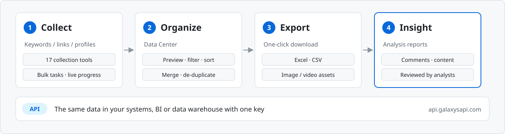
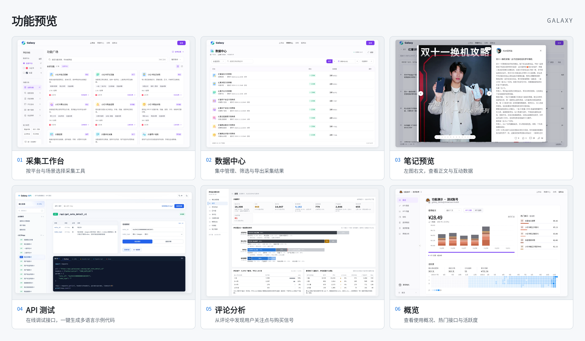

<h1 align="center">Galaxy API · Media Data Collection & Analysis</h1>

<p align="center">
  Collect, organize and analyze Xiaohongshu (RedNote) and Douyin data in bulk — no code required.
</p>

<p align="center">
  <a href="README.md">简体中文</a> · <b>English</b>
</p>

<p align="center">
  <a href="https://galaxysapi.com/login?mode=register&utm_source=github&utm_medium=readme&utm_campaign=xiaohongshu"></a>
  <a href="https://galaxysapi.com/platform?utm_source=github&utm_medium=readme&utm_campaign=xiaohongshu"></a>
  <a href="https://galaxysapi.com/api-docs/?utm_source=github&utm_medium=readme&utm_campaign=xiaohongshu"></a>
</p>

## 📦 Supported features

**4** platforms · **17** no-code tools · **49** API endpoints · **2** types of analysis reports

| Platform | Keyword search | Content detail | Comments · replies | User profile | Posts | Followers | Products | Creator metrics |
| :-- | :-: | :-: | :-: | :-: | :-: | :-: | :-: | :-: |
| **Xiaohongshu** | ✅ | ✅ | ✅ | ✅ | ✅ | 🔌 | ✅ | ➖ |
| **Xiaohongshu Pugongying** | 🔌 | 🔌 | ➖ | 🔌 | 🔌 | 🔌 | ➖ | 🔌 |
| **Douyin** | ✅ | ✅ | ✅ | ✅ | ✅ | ✅ | ➖ | ➖ |
| **Bilibili** | 🔌 | 🔌 | 🔌 | 🔌 | 🔌 | ➖ | ➖ | ➖ |

<sub>✅ Web workbench + API　🔌 API only　➖ Not supported yet　|　Pugongying "followers" means follower growth and tags. Full list: <a href="docs/endpoints.md">endpoint catalog</a> (Chinese).</sub>

## 🎯 Use cases

<table>
  <tr>
    <td width="33%" valign="top"><b>📝 Content teams</b><br><sub>What is trending in my niche?</sub><br><code>Note search</code> <code>Creator posts</code></td>
    <td width="33%" valign="top"><b>💬 Brand & marketing</b><br><sub>What do users say about us and rivals?</sub><br><code>Comments</code> <code>Comment analysis</code></td>
    <td width="33%" valign="top"><b>🛒 E-commerce</b><br><sub>Which products are worth selling?</sub><br><code>Product search</code> <code>Reviews</code></td>
  </tr>
  <tr>
    <td valign="top"><b>🤝 Influencer marketing</b><br><sub>Is this creator worth the budget?</sub><br><code>User profile</code> <code>Pugongying API</code></td>
    <td valign="top"><b>🎬 Short-video teams</b><br><sub>How are similar videos made?</sub><br><code>Douyin search</code> <code>Content analysis</code></td>
    <td valign="top"><b>👩‍💻 Developers</b><br><sub>No crawler to maintain</sub><br><code>One API</code> <code>Standard JSON</code></td>
  </tr>
</table>

## 🔄 Workflow

<picture>
  <source media="(prefers-color-scheme: dark)" srcset="assets/workflow.en-dark.svg">
  
</picture>

| Option | 🖱️ Web workbench | 📊 Analysis reports | 🔌 API |
| :-- | :-- | :-- | :-- |
| **Best for** | Operations, marketing, research | Teams that need conclusions | Developers, data teams |
| **Code** | Not needed | Not needed | Needed |
| **Output** | Tables, Excel / CSV, media assets | Comment and video content analysis | JSON for your own systems |
| **Start** | [Open workbench →](https://galaxysapi.com/platform?utm_source=github&utm_medium=readme&utm_campaign=xiaohongshu) | [Sample report →](https://galaxysapi.com/api/reports/sample?utm_source=github&utm_medium=readme&utm_campaign=xiaohongshu) | [API docs →](https://galaxysapi.com/api-docs/?utm_source=github&utm_medium=readme&utm_campaign=xiaohongshu) |

## 💰 Pricing

**Low prices, straight from the source: ¥0.02 per request for common endpoints, failed requests free, no monthly fee.** New accounts get ¥1 free credit. [Full pricing →](https://galaxysapi.com/api-docs/?utm_source=github&utm_medium=readme&utm_campaign=xiaohongshu#pricing)

## ⚖️ Comparison

| Item | DIY crawler | Galaxy API |
| :-- | :-- | :-- |
| Upfront cost | Accounts, proxies, servers, dev time | ✅ Sign up and go, ¥1 free credit |
| Accounts / cookies | Source them yourself, replace when they expire | ✅ Not needed |
| Proxy IPs | Buy and rotate yourself | ✅ Not needed |
| Signing / anti-bot | Re-adapt after every platform update | ✅ Handled for you |
| Failed requests | Still cost you resources | ✅ Not billed |
| No coding skills | Not usable | ✅ Web workbench |

## 🖼️ Product interface

[](assets/screenshots/platform-overview.png)

<sub>Production platform (Chinese UI). Data Center and note preview use public samples; the overview uses a demo account. <a href="docs/platform.md">Platform details →</a></sub>

## ⚡ Quick start

```bash
curl -G 'https://api.galaxysapi.com/api/search_note_v1' \
  -H "Authorization: $GALAXY_API_KEY" \
  --data-urlencode 'keyword=coffee'
```

No key yet? Run the offline demo — no request, no charge:

```bash
git clone https://github.com/luckfexuanxuan-code/galaxyapi.git && cd galaxyapi
python3 examples/python/call.py search --demo --csv output/demo.csv
```

<details>
<summary>More examples and response format</summary>

<br>

Create a key on the console [API keys](https://galaxysapi.com/console/api-keys?utm_source=github&utm_medium=readme&utm_campaign=xiaohongshu) page and put it in the `Authorization` header as-is (no `Bearer ` prefix). The scripts need Python 3.10+ / Node.js 22+ and use the standard library only.

```bash
export GALAXY_API_KEY='your_api_key'

# Search notes and save as CSV
python3 examples/python/call.py search --keyword coffee --csv output/notes.csv

# Note comments / Pugongying creator profile
python3 examples/python/call.py comments --note_id YOUR_NOTE_ID
node examples/node/call.mjs pgy --user_id YOUR_USER_ID
```

```json
{
  "code": 200,
  "message": "成功",
  "data": {
    "items": [
      {
        "model_type": "note",
        "note": {
          "id": "EXAMPLE_NOTE_ID",
          "title": "Example note title",
          "liked_count": 381,
          "comments_count": 95,
          "collected_count": 348
        }
      }
    ]
  }
}
```

[All examples](examples/README.md) · [Parameters & paging](docs/quickstart.md) · [Troubleshooting](docs/troubleshooting.md) · [Sanitized responses](examples/responses)

</details>

## ❓ FAQ

<details><summary><b>How do I top up? Is there a minimum spend?</b></summary><br>No monthly fee or plan — you pay for what you use. New accounts get ¥1 free credit, and online top-ups start at ¥10. Workbench tasks are charged by pages actually requested and stop billing when a task ends early.</details>

<details><summary><b>Are reports generated automatically?</b></summary><br>No. After you submit data and confirm the order, analysts process and review the report before delivery. Comment analysis currently focuses on Xiaohongshu beauty and personal care; video content analysis supports Xiaohongshu video voice-overs.</details>

<details><summary><b>What can the data be used for?</b></summary><br>Only publicly visible data is provided, for content research, competitor analysis, reputation monitoring, product selection and creator evaluation. Follow platform rules and applicable laws; do not infringe personal privacy.</details>

<br>

<p align="center">
  <a href="https://galaxysapi.com/login?mode=register&utm_source=github&utm_medium=readme&utm_campaign=xiaohongshu"><picture><source media="(prefers-color-scheme: dark)" srcset="assets/cta.en-dark.svg"></picture></a>
</p>

<p align="center">
  <a href="https://galaxysapi.com/guides/xiaohongshu-comment-collection?utm_source=github&utm_medium=readme&utm_campaign=xiaohongshu">Comment collection</a> ·
  <a href="https://galaxysapi.com/guides/xiaohongshu-excel-export?utm_source=github&utm_medium=readme&utm_campaign=xiaohongshu">Excel export</a> ·
  <a href="https://galaxysapi.com/guides/xiaohongshu-comment-analysis?utm_source=github&utm_medium=readme&utm_campaign=xiaohongshu">Comment analysis</a> ·
  <a href="https://galaxysapi.com/guides/xiaohongshu-api-integration?utm_source=github&utm_medium=readme&utm_campaign=xiaohongshu">API integration</a> ·
  <a href="https://github.com/luckfexuanxuan-code/galaxyapi/issues">Open an Issue</a>
  <br><sub>Guides are in Chinese · Example code under the <a href="LICENSE">MIT</a> license · Platform services billed per <a href="https://galaxysapi.com/?utm_source=github&utm_medium=readme&utm_campaign=xiaohongshu">galaxysapi.com</a> rules</sub>
</p>
