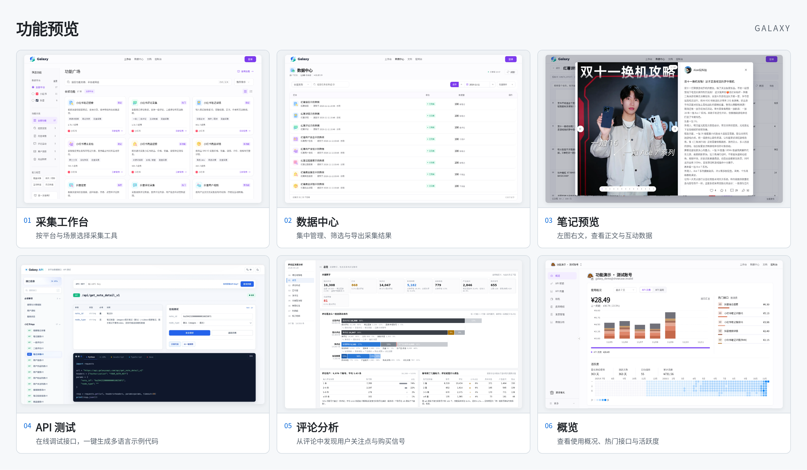
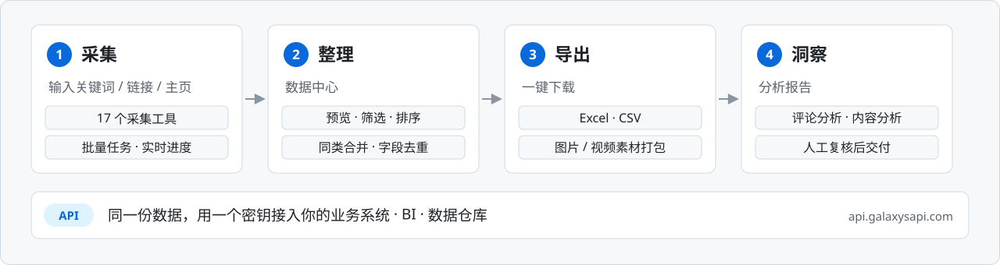

<h1 align="center">Galaxy API · 自媒体数据采集分析平台</h1>

<p align="center">
  小红书、抖音数据，不写代码也能批量采集、整理、分析。
</p>

<p align="center">
  <b>简体中文</b> · <a href="README.en.md">English</a>
</p>

<p align="center">
  <a href="https://galaxysapi.com/login?mode=register&utm_source=github&utm_medium=readme&utm_campaign=xiaohongshu"></a>
  <a href="https://galaxysapi.com/platform?utm_source=github&utm_medium=readme&utm_campaign=xiaohongshu"></a>
  <a href="https://galaxysapi.com/api-docs/?utm_source=github&utm_medium=readme&utm_campaign=xiaohongshu"></a>
</p>

## 🖼️ 产品界面

[](assets/screenshots/platform-overview.png)

<sub>数据中心与笔记预览为平台公开示例，概览为演示账号。<a href="docs/platform.md">平台功能详解 →</a></sub>

## 📦 功能支持

**4** 个平台 · **17** 个免代码采集工具 · **49** 个 API 接口 · **2** 类分析报告

| 平台 | 关键词搜索 | 内容详情 | 评论 · 回复 | 用户资料 | 作品列表 | 粉丝 | 商品 | 达人数据 |
| :-- | :-: | :-: | :-: | :-: | :-: | :-: | :-: | :-: |
| **小红书** | ✅ | ✅ | ✅ | ✅ | ✅ | 🔌 | ✅ | ➖ |
| **小红书蒲公英** | 🔌 | 🔌 | ➖ | 🔌 | 🔌 | 🔌 | ➖ | 🔌 |
| **抖音** | ✅ | ✅ | ✅ | ✅ | ✅ | ✅ | ➖ | ➖ |
| **哔哩哔哩** | 🔌 | 🔌 | 🔌 | 🔌 | 🔌 | ➖ | ➖ | ➖ |

<sub>✅ 网页工作台 + API　🔌 仅 API　➖ 暂不支持　｜　蒲公英「粉丝」为粉丝增长与粉丝标签。完整清单见 <a href="docs/endpoints.md">接口目录</a>。</sub>

## 🎯 应用场景

<table>
  <tr>
    <td width="33%" valign="top"><b>📝 内容运营</b><br><sub>这个赛道什么内容在爆？</sub><br><code>笔记搜索</code> <code>博主发帖</code></td>
    <td width="33%" valign="top"><b>💬 品牌市场</b><br><sub>用户怎么评价我和竞品？</sub><br><code>评论采集</code> <code>评论分析</code></td>
    <td width="33%" valign="top"><b>🛒 电商选品</b><br><sub>哪些商品值得做？</sub><br><code>商品搜索</code> <code>商品评论</code></td>
  </tr>
  <tr>
    <td valign="top"><b>🤝 达人投放</b><br><sub>这个达人值不值得投？</sub><br><code>用户信息</code> <code>蒲公英 API</code></td>
    <td valign="top"><b>🎬 短视频团队</b><br><sub>同类视频是怎么做的？</sub><br><code>抖音搜索</code> <code>内容分析</code></td>
    <td valign="top"><b>👩‍💻 开发者</b><br><sub>不想自己维护爬虫</sub><br><code>统一 API</code> <code>标准 JSON</code></td>
  </tr>
</table>

## 🔄 工作流程

<picture>
  <source media="(prefers-color-scheme: dark)" srcset="assets/workflow-dark.svg">
  
</picture>

| 使用方式 | 🖱️ 网页工作台 | 📊 分析报告 | 🔌 API |
| :-- | :-- | :-- | :-- |
| **适用人群** | 运营、市场、研究 | 需要结论的团队 | 开发者、数据团队 |
| **是否编程** | 不需要 | 不需要 | 需要 |
| **交付内容** | 表格数据、Excel / CSV、素材 | 评论分析、视频内容分析报告 | JSON，接入自有系统 |
| **入口** | [打开工作台 →](https://galaxysapi.com/platform?utm_source=github&utm_medium=readme&utm_campaign=xiaohongshu) | [看报告示例 →](https://galaxysapi.com/api/reports/sample?utm_source=github&utm_medium=readme&utm_campaign=xiaohongshu) | [看 API 文档 →](https://galaxysapi.com/api-docs/?utm_source=github&utm_medium=readme&utm_campaign=xiaohongshu) |

## 💰 价格

**源头资源，价格低廉：常用接口 ¥0.02 / 次，失败请求不计费，没有月费。** 注册即送 ¥1 体验金，[查看完整价格 →](https://galaxysapi.com/api-docs/?utm_source=github&utm_medium=readme&utm_campaign=xiaohongshu#pricing)

## ⚖️ 方案对比

| 对比项 | 自建爬虫 | Galaxy API |
| :-- | :-- | :-- |
| 起步成本 | 账号、代理、服务器、开发时间 | ✅ 注册即用，送 ¥1 体验金 |
| 账号 / Cookie | 自己准备，过期要换 | ✅ 不需要 |
| 代理 IP | 自己采购、轮换 | ✅ 不需要 |
| 签名 / 风控 | 平台一更新就要重新适配 | ✅ 平台处理 |
| 失败请求 | 照样消耗资源 | ✅ 不计费 |
| 不会写代码 | 用不了 | ✅ 网页工作台 |

## ⚡ 快速开始

```bash
curl -G 'https://api.galaxysapi.com/api/search_note_v1' \
  -H "Authorization: $GALAXY_API_KEY" \
  --data-urlencode 'keyword=咖啡'
```

还没有 Key？先跑离线演示，不发请求、不收费：

```bash
git clone https://github.com/luckfexuanxuan-code/galaxyapi.git && cd galaxyapi
python3 examples/python/call.py search --demo --csv output/demo.csv
```

<details>
<summary>更多示例与返回结构</summary>

<br>

API Key 在控制台 [API 密钥](https://galaxysapi.com/console/api-keys?utm_source=github&utm_medium=readme&utm_campaign=xiaohongshu) 页面创建，直接放在 `Authorization` 请求头中，不加 `Bearer ` 前缀。示例脚本支持 Python 3.10+ / Node.js 22+，只用标准库。

```bash
export GALAXY_API_KEY='你的_API_Key'

# 搜索笔记并存为 CSV
python3 examples/python/call.py search --keyword 咖啡 --csv output/notes.csv

# 笔记评论 / 蒲公英达人资料
python3 examples/python/call.py comments --note_id YOUR_NOTE_ID
node examples/node/call.mjs pgy --user_id YOUR_USER_ID
```

```json
{
  "code": 200,
  "message": "成功",
  "data": {
    "items": [
      {
        "model_type": "note",
        "note": {
          "id": "EXAMPLE_NOTE_ID",
          "title": "示例笔记标题",
          "liked_count": 381,
          "comments_count": 95,
          "collected_count": 348
        }
      }
    ]
  }
}
```

[全部示例](examples/README.md) · [参数与分页](docs/quickstart.md) · [错误处理](docs/troubleshooting.md) · [脱敏返回示例](examples/responses)

</details>

## ❓ 常见问题

<details><summary><b>怎么充值？有最低消费吗？</b></summary><br>没有月费和套餐，用多少扣多少。注册即送 ¥1 体验金，在线充值最低 ¥10。工作台任务按实际请求页数扣费，提前结束不再扣费。</details>

<details><summary><b>分析报告是自动生成的吗？</b></summary><br>不是。提交数据并确认订单后，由分析人员处理、复核后交付。评论分析目前面向小红书美妆、个护类目，视频内容分析支持小红书视频口播。</details>

<details><summary><b>数据可以用来做什么？</b></summary><br>只提供公开可见的数据，用于内容研究、竞品分析、口碑监测、选品和达人评估。请遵守平台规则与相关法律法规，不得侵犯个人隐私。</details>

<br>

<p align="center">
  <a href="https://galaxysapi.com/login?mode=register&utm_source=github&utm_medium=readme&utm_campaign=xiaohongshu"><picture><source media="(prefers-color-scheme: dark)" srcset="assets/cta-dark.svg"></picture></a>
</p>

<p align="center">
  <a href="https://galaxysapi.com/guides/xiaohongshu-comment-collection?utm_source=github&utm_medium=readme&utm_campaign=xiaohongshu">评论采集教程</a> ·
  <a href="https://galaxysapi.com/guides/xiaohongshu-excel-export?utm_source=github&utm_medium=readme&utm_campaign=xiaohongshu">导出 Excel 教程</a> ·
  <a href="https://galaxysapi.com/guides/xiaohongshu-comment-analysis?utm_source=github&utm_medium=readme&utm_campaign=xiaohongshu">评论分析教程</a> ·
  <a href="https://galaxysapi.com/guides/xiaohongshu-api-integration?utm_source=github&utm_medium=readme&utm_campaign=xiaohongshu">API 接入教程</a> ·
  <a href="https://github.com/luckfexuanxuan-code/galaxyapi/issues">提交 Issue</a>
  <br><sub>示例代码基于 <a href="LICENSE">MIT</a> 许可开源 · 平台服务按 <a href="https://galaxysapi.com/?utm_source=github&utm_medium=readme&utm_campaign=xiaohongshu">galaxysapi.com</a> 规则计费</sub>
</p>

最后更新：2026-11-19
