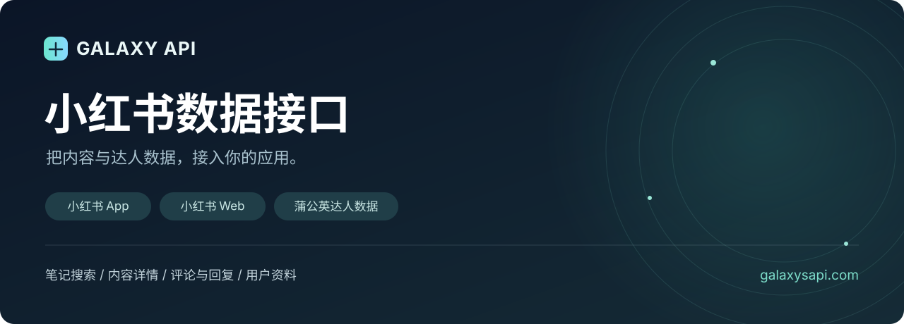
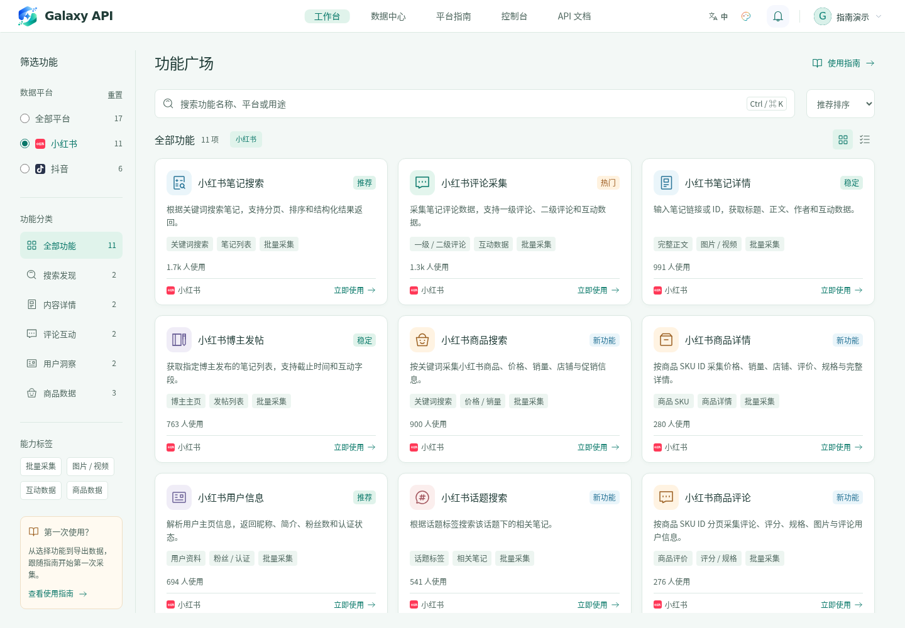
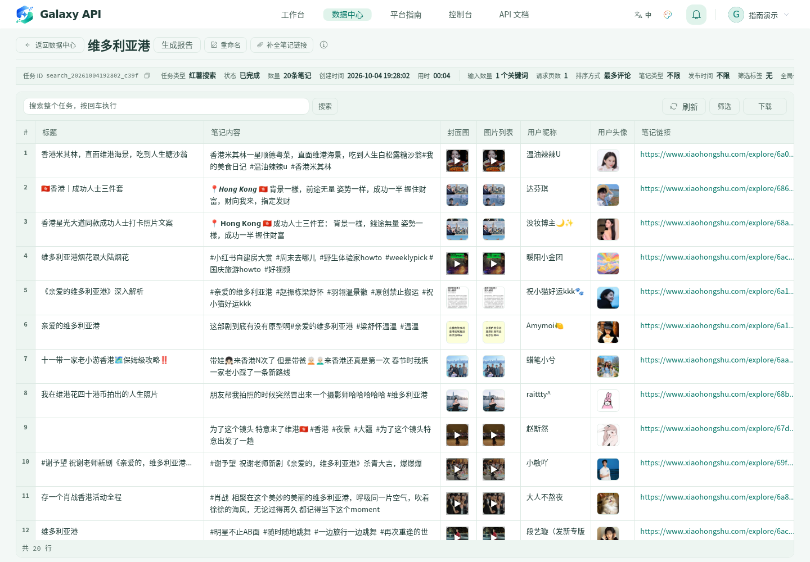
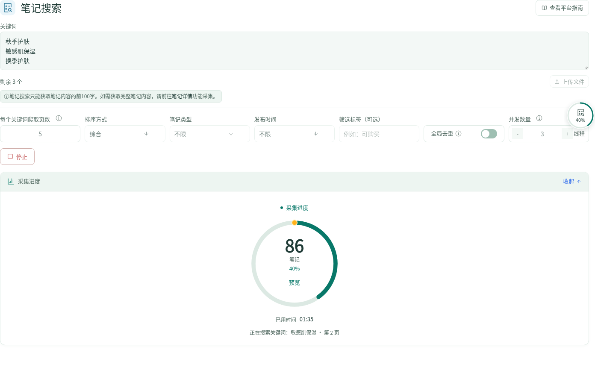
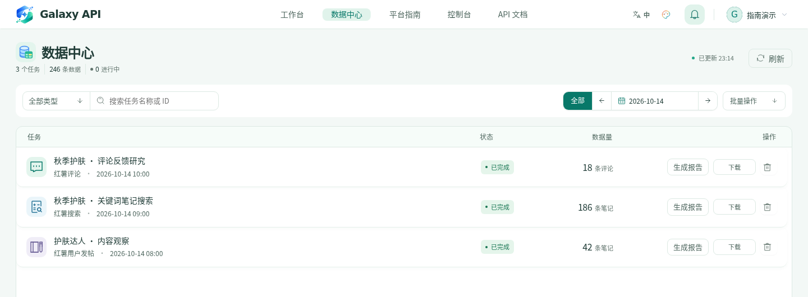
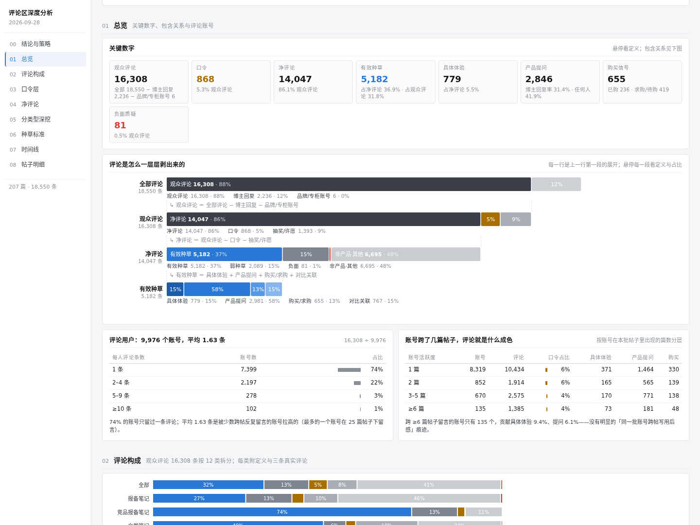
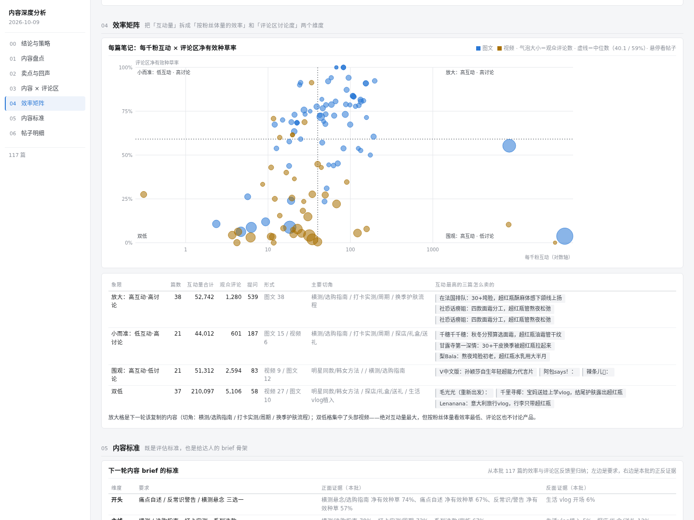

<p align="center"></p>

# Galaxy API｜小红书数据采集分析平台

**从采集笔记与评论，到整理数据、研究用户反馈和内容表现。**

Galaxy API 是以小红书为核心的数据采集分析平台。你可以在网页工作台输入关键词、笔记链接或用户主页，创建采集任务，在数据中心预览、筛选、合并和导出结果，并按需要提交评论分析或视频内容分析。

平台同时提供小红书 App、Web 及蒲公英 API，覆盖笔记搜索、内容详情、评论回复、用户作品与达人数据查询，方便开发者接入自己的应用。本仓库包含平台功能展示、界面截图、API 接入说明、可运行代码和脱敏返回示例。

**[进入采集工作台](https://galaxysapi.com/platform?utm_source=github&utm_medium=readme&utm_campaign=xiaohongshu)** · **[查看接口文档](https://galaxysapi.com/api-docs/?utm_source=github&utm_medium=readme&utm_campaign=xiaohongshu)** · **[注册账号](https://galaxysapi.com/login?mode=register&utm_source=github&utm_medium=readme&utm_campaign=xiaohongshu)** · [English](README.en.md)

## 平台能做什么

| 模块 | 平台功能 | 使用场景 |
| --- | --- | --- |
| 可视化采集 | 通过表单批量输入关键词、笔记链接或用户主页，按功能配置采集参数 | 笔记搜索、评论采集、博主作品与用户资料整理 |
| 任务管理 | 查看实时采集进度、结果数量和任务状态；切换页面后通过浮动进度继续查看 | 同时跟进多个采集任务 |
| 数据中心 | 按类型、名称和日期查找任务，预览表格、正文与互动字段 | 集中管理采集结果 |
| 筛选与整理 | 全任务搜索、关键词与数值/时间条件筛选、排序，同类型任务合并并按字段去重 | 筛选高互动内容、汇总多批次数据 |
| 文件与素材 | 导出 CSV、XLSX；支持的任务可预览图片、视频并下载已归档素材 | 本地分析、团队协作、素材研究 |
| 评论分析 | 从评论任务或本地文件提交数据，查看用户关注点、购买信号、负面顾虑、竞品提及和逐篇诊断 | 美妆、个护类目的用户反馈研究 |
| 视频内容分析 | 提交小红书视频链接，围绕口播原文、开头、内容主线、产品植入与互动表现进行拆解 | 复盘内容打法，形成下一轮内容 brief |
| API 接入 | 使用小红书 App、Web 与蒲公英接口，并通过控制台管理密钥和调用记录 | 接入业务系统或自有分析工具 |

**使用流程：选择功能 → 填写参数 → 创建采集任务 → 预览与整理数据 → 导出或提交分析。**

[平台功能详解](docs/platform.md) · [使用指南](https://galaxysapi.com/docs/crawling?utm_source=github&utm_medium=readme&utm_campaign=xiaohongshu) · [数据中心](https://galaxysapi.com/data?utm_source=github&utm_medium=readme&utm_campaign=xiaohongshu) · [数据分析](https://galaxysapi.com/console/comment-reports?utm_source=github&utm_medium=readme&utm_campaign=xiaohongshu)

## 平台界面

**功能广场：按平台和用途选择采集工具。**



**数据预览：查看笔记标题、正文、图片与互动信息，进一步筛选或导出。**



截图任务：`search_20261004192802_c39f`，关键词“维多利亚港”，共 20 条笔记。

<details>
<summary>展开查看采集进度、数据中心和分析报告截图</summary>

**批量采集与进度**



**数据中心任务管理**



**评论分析报告示例**



[打开完整评论报告示例](https://galaxysapi.com/api/reports/sample?utm_source=github&utm_medium=readme&utm_campaign=xiaohongshu)

**视频内容分析报告示例**



[打开完整内容报告示例](https://galaxysapi.com/api/reports/content-sample?utm_source=github&utm_medium=readme&utm_campaign=xiaohongshu)

</details>

## 小红书 API：从内容发现到达人研究

| 能力 | 可以获取什么 | 文档 |
| --- | --- | --- |
| 笔记搜索 | 按关键词查找笔记，按排序、内容类型等条件筛选 | [搜索接口](https://galaxysapi.com/api-docs/?utm_source=github&utm_medium=readme&utm_campaign=xiaohongshu#api-search_note_v1) |
| 笔记详情 | 图文或视频笔记的正文、作者与互动信息 | [详情接口](https://galaxysapi.com/api-docs/?utm_source=github&utm_medium=readme&utm_campaign=xiaohongshu#api-get_note_detail_v1) |
| 评论与回复 | 一级评论、二级回复，按接口参数分页读取 | [评论接口](https://galaxysapi.com/api-docs/?utm_source=github&utm_medium=readme&utm_campaign=xiaohongshu#api-get_note_comment_v1) |
| 用户与作品 | 用户资料、作品列表、用户搜索 | [小红书 App](https://galaxysapi.com/api-docs/?utm_source=github&utm_medium=readme&utm_campaign=xiaohongshu#group-xiaohongshu-app) |
| Web 接口 | Web 端笔记详情、搜索、评论等能力 | [小红书 Web](https://galaxysapi.com/api-docs/?utm_source=github&utm_medium=readme&utm_campaign=xiaohongshu#group-xiaohongshu-web) |
| 商品与话题 | 商品搜索、详情、评论及话题笔记 | [完整目录](docs/endpoints.md) |

### 蒲公英：小红书达人数据

查看达人资料、数据表现、成长表现、笔记列表、粉丝增长和粉丝标签，将内容数据与达人研究结合起来。

- [作者信息](https://galaxysapi.com/api-docs/?utm_source=github&utm_medium=readme&utm_campaign=xiaohongshu#api-pgy_author_info)：从小红书用户 ID 查询达人资料。
- [全部蒲公英接口](https://galaxysapi.com/api-docs/?utm_source=github&utm_medium=readme&utm_campaign=xiaohongshu#group-xiaohongshu-pgy)：按场景选择指标与参数。
- [本地返回示例](examples/responses/pgy_author_info.json)：查看脱敏后的字段结构。

## API 快速开始

1. [注册 Galaxy API 账号](https://galaxysapi.com/login?mode=register&utm_source=github&utm_medium=readme&utm_campaign=xiaohongshu)，完成邮箱验证。
2. 在控制台的 [API 密钥](https://galaxysapi.com/console/api-keys?utm_source=github&utm_medium=readme&utm_campaign=xiaohongshu) 页面创建密钥，并确认账户余额及密钥配额。
3. 通过请求头 `Authorization` 直接传入完整 API Key。

请求地址：`https://api.galaxysapi.com`。这里直接填写密钥，不加 `Bearer ` 前缀。

```bash
export GALAXY_API_KEY='替换为你的_API_Key'

curl --get 'https://api.galaxysapi.com/api/search_note_v1' \
  --header "Authorization: $GALAXY_API_KEY" \
  --data-urlencode 'keyword=咖啡' \
  --data-urlencode 'page=1' \
  --data-urlencode 'page_size=20' \
  --connect-timeout 10 --max-time 60 --fail-with-body
```

API 调用按平台规则计费；示例代码本身不收费。以下脚本每次运行只请求一页，不自动重试或连续翻页。

### Python / Node.js

Python 3.10+、Node.js 22+，均使用标准库，无需安装第三方依赖。

```bash
git clone https://github.com/luckfexuanxuan-code/galaxy-xiaohongshu-api.git
cd galaxy-xiaohongshu-api

# 搜索小红书笔记
python3 examples/python/call.py search --keyword 咖啡
node examples/node/call.mjs search --keyword 咖啡

# 将这一页搜索结果整理为 CSV
python3 examples/python/call.py search --keyword 咖啡 --csv output/notes.csv

# 查询笔记、评论、用户或蒲公英达人资料：替换为真实有效的 ID
python3 examples/python/call.py note --note_id YOUR_NOTE_ID
python3 examples/python/call.py comments --note_id YOUR_NOTE_ID
python3 examples/python/call.py user --user_id YOUR_USER_ID
python3 examples/python/call.py pgy --user_id YOUR_USER_ID
```

想先看输出结构，可以运行离线演示；`--demo` 不需要密钥，不发起 API 请求，也不产生费用。

```bash
python3 examples/python/call.py search --demo --csv output/demo.csv
node examples/node/call.mjs pgy --demo
```

[全部运行方式](examples/README.md) · [参数与分页说明](docs/quickstart.md) · [错误处理](docs/troubleshooting.md)

## 返回示例

下面节选自笔记搜索响应。名称、标识和内容已经替换为示例值，部分字段省略；仅用于展示结构，不代表实时查询结果。

```json
{
  "code": 200,
  "message": "成功",
  "data": {
    "items": [
      {
        "model_type": "note",
        "note": {
          "id": "EXAMPLE_NOTE_ID",
          "title": "示例笔记标题",
          "user": { "userid": "EXAMPLE_USER_ID", "nickname": "示例用户" },
          "liked_count": 381,
          "comments_count": 95,
          "collected_count": 348
        }
      }
    ]
  }
}
```

各接口的 `data` 结构可能不同。完整字段及更多示例请查看对应的 [API 文档](https://galaxysapi.com/api-docs/?utm_source=github&utm_medium=readme&utm_campaign=xiaohongshu)。

## 开通与使用

[注册账号](https://galaxysapi.com/login?mode=register&utm_source=github&utm_medium=readme&utm_campaign=xiaohongshu) · [打开工作台](https://galaxysapi.com/platform?utm_source=github&utm_medium=readme&utm_campaign=xiaohongshu) · [查看接入文档](https://galaxysapi.com/api-docs/?utm_source=github&utm_medium=readme&utm_campaign=xiaohongshu) · [控制台](https://galaxysapi.com/console/dashboard?utm_source=github&utm_medium=readme&utm_campaign=xiaohongshu)

## 反馈与维护

- 接入或示例问题：提交 [Issue](https://github.com/luckfexuanxuan-code/galaxy-xiaohongshu-api/issues)，附接口名、时间、状态码和脱敏后的错误说明。
- 余额、密钥等账户事项：登录 [Galaxy API](https://galaxysapi.com/?utm_source=github&utm_medium=readme&utm_campaign=xiaohongshu) 后通过平台客服处理。不要在 Issue 中提交 API Key 或账户信息。
